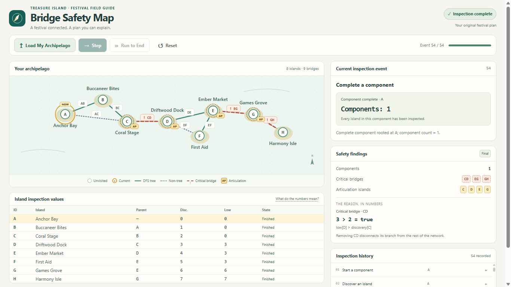

# Treasure-Island Bridge Safety Map

A local React + TypeScript application that lets a festival volunteer inspect an island network and explain critical bridges and articulation islands using visible DFS evidence.

All five phases are complete. The interface includes the responsive native SVG map, Load/Step/Run to End/Reset controls, numerical event explanations, expandable history, traversal table, and safety summary.



## Run locally

In Windows PowerShell:

```powershell
Set-Location "C:\Users\UDAY\Documents\Codex\2026-11-02\x20\outputs\treasure-island-map"
npm.cmd ci
npm.cmd run dev -- --host 127.0.0.1 --port 5175 --strictPort
```

Open [the local application](http://127.0.0.1:5175/) after Vite starts. Existing installations can start with the final command. Stop the server with Ctrl+C. The verification server is stopped after the checks; this project is local and has not been published.

Click **Load My Archipelago**, then **Step** for one recorded event or **Run to End** for the completed inspection. **Reset** restores the original unvisited network. Expand an entry in Inspection history to read its recorded proof.

## Verification

```powershell
npm.cmd run test:run
npm.cmd run build
npm.cmd run lint
```

The Phase 5 checkpoint passed **293 tests in 12 files**, production build, and lint. This includes all 261 previous tests and 32 new component/application cases. Actual Chrome checks covered 1366 × 768 desktop and 390 × 844 mobile emulation, keyboard Step, the three required numerical proofs, completion, and Reset.

A subsequent audit reproduced a five-second timeout in the 54-event integration test. All 293 tests passed with a diagnostic 15-second timeout and one worker; build/lint passed. A permanent fix for the normal test command remains pending. See the current qualification in [the development record](docs/ai-prompts.md#actual-iterations).

See [Phase 5 evidence](docs/phase-5-evidence.md), [browser measurements](docs/browser-check-results.json), and the [interview walkthrough](docs/demo-walkthrough.md). Cross-browser, physical-phone, and screen-reader testing were not performed.

## Architecture

- **Domain:** readonly graph contracts, runtime validation, sorted adjacency, the GraphAnalyzer Strategy, Tarjan DFS, typed events, and deeply immutable snapshots. No React imports.
- **Application:** AnalysisService with constructor-injected GraphAnalyzer; pure replay state, reducer, and selectors.
- **Presentation:** App composes the service and useReplayController. IslandMap, ReplayControls, EventPanel, EventHistory, NodeTable, and SafetySummary receive the same ReplayView. EventProof formats typed recorded details.
- **Data:** createFestivalArchipelago returns fresh original demo data. The controller captures independent original values for Reset.
- **Tests:** Node-based domain/application tests and file-scoped jsdom React tests; independent reference fixtures remain outside production code.

Only Load calls AnalysisService.prepare and executes DFS. Navigation, Reset, rerenders, and history expansion use the prepared immutable history. Panels read only the selected snapshot and already-replayed events; future classifications are never exposed early.

The stack is React, TypeScript, Vite, Tailwind CSS, native SVG, React useReducer, Vitest, React Testing Library, jsdom, and Oxlint. Phase 5 adds no dependencies or external services.

## Expected demonstration

The original eight-island network produces 54 deterministic events:

- Event 21: returning F → E changes low[E] from 4 to 3.
- Event 39: DE is not a bridge because 3 > 3 is false.
- Event 40: D becomes an articulation island because 3 ≥ 3 is true.
- Completion: bridges **CD, EG, GH**; articulation islands **C, D, E, G**; **1** component.

These numbers are calculated by the analyzer. The hand-derived expected table exists only in documentation/tests.

The engine accepts 1..12 nodes and 0..20 undirected edges, including disconnected graphs and isolated nodes. Validation errors identify their fields/items and clear all earlier visible analysis. The volunteer interface loads the original demo; dependency-injected tests exercise invalid input without adding testing controls to the page.

## Project documentation

- [Implementation plan and phase gates](docs/implementation-plan.md)
- [Architecture, UML, and sequences](docs/design.md)
- [Independent graph/reference table](docs/reference-graph.md)
- [Event schema and emission rules](docs/event-schema.md)
- [Replay/controller contract](docs/replay-controller.md)
- [Presentation design and accessibility](docs/ui-design.md)
- [AI prompting strategy, engineering decisions, and development record](docs/ai-prompts.md)
- [Refined engineering prompt portfolio](docs/prompts/refined-engineering-prompts.md)
- [Interview discussion and follow-up questions](docs/interview-discussion.md)
- [Phase 1 evidence](docs/phase-1-evidence.md), [Phase 2 evidence](docs/phase-2-evidence.md), [Phase 3 evidence](docs/phase-3-evidence.md), [Phase 4 evidence](docs/phase-4-evidence.md), [Phase 5 evidence](docs/phase-5-evidence.md)
