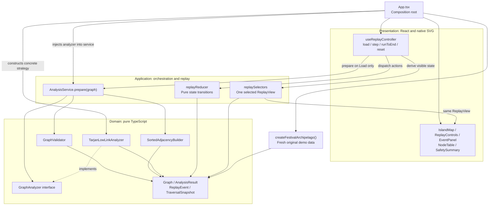
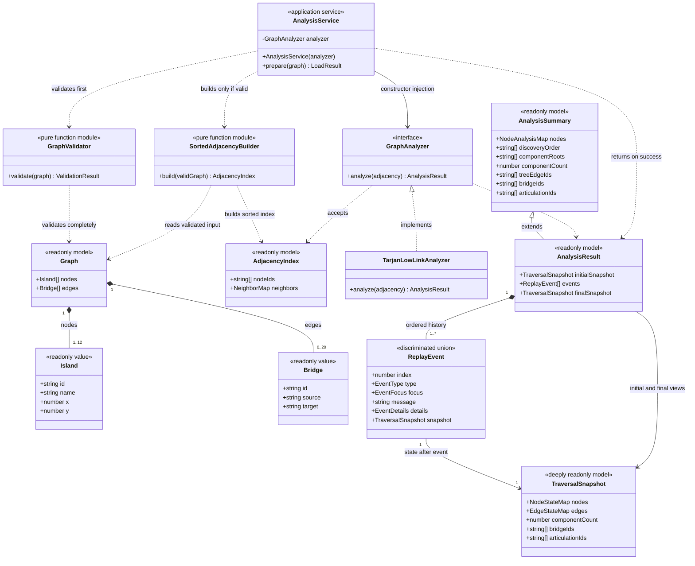
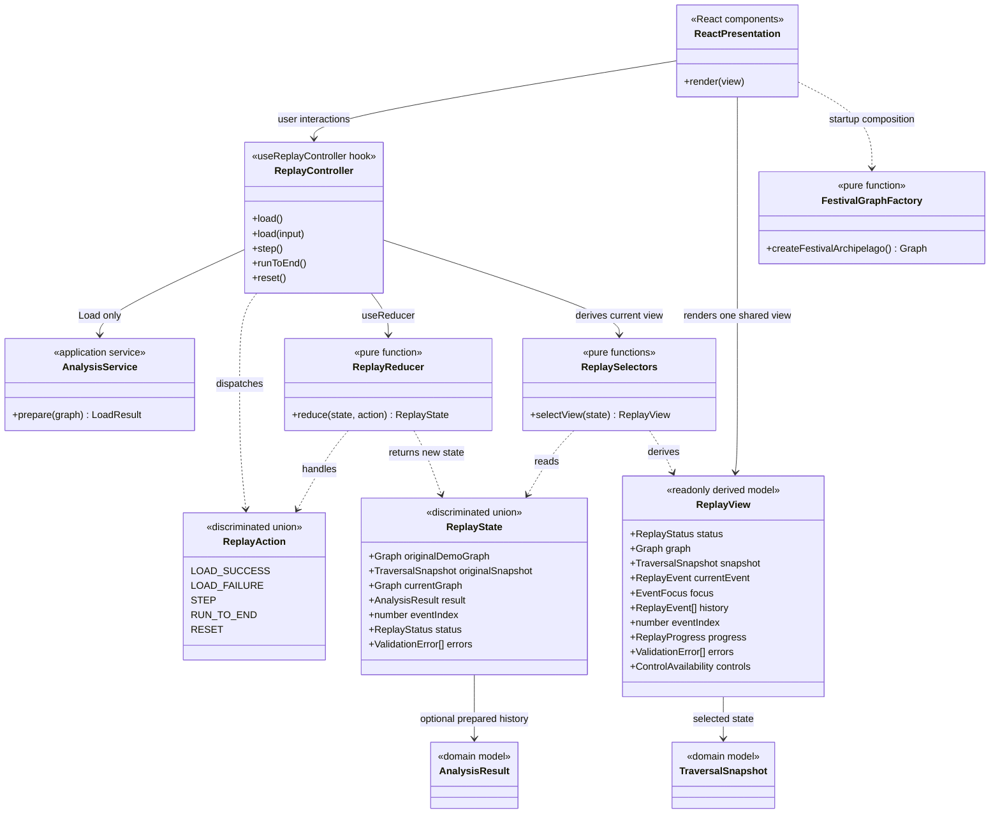

# Treasure-Island Bridge Safety Map: UML and sequence design

Implementation status: Phases 1 through 4 are complete. AnalysisResult preserves the calculated values and immutable replay envelope. Pure application replay state/selectors and the injected React hook are implemented; analyzer/service boundaries are unchanged. Page/map components remain Phase 5. See event-schema.md, replay-controller.md, and phase-4-evidence.md.

This design follows the finalized interview plan: React + TypeScript + Vite, Tailwind CSS, native SVG, React useReducer, Vitest, and React Testing Library. Calculation and replay are local.

The diagrams describe implementation responsibilities. A box marked "pure function module" is a TypeScript function/module; ReplayController is a React hook. Only the analyzer strategy and injected AnalysisService need class-style construction.

## 1. Architecture and dependency boundaries

Domain modules import no React or application code. Application modules import domain types and contracts. Presentation composes the application and domain implementations. Graph coordinates affect SVG layout only.

Arrows below show uses or data dependencies, with labels distinguishing the selected view passed to components.



## 2. Domain and analysis UML class diagram

AnalysisService.prepare is the validation gate. It either returns a successful graph plus analysis, or identifiable validation errors. Invalid input never reaches adjacency construction or the analyzer.



Supporting type contracts:

- AnalysisSummary holds the original node table, discovery order, component roots/count, tree-edge IDs, and critical IDs. AnalysisResult extends it with the immutable replay envelope.

- Island: readonly id, name, x, y. Bridge: readonly id, source, target. Graph owns readonly node/edge arrays.
- ValidationResult: a discriminated union of valid and invalid-with-errors. Each ValidationError identifies the affected field and relevant node, edge, or endpoint where applicable.
- LoadResult: a discriminated union of success(graph, result) and failure(errors).
- AdjacencyIndex.nodeIds: every node ID, including isolated nodes, sorted by ascending ASCII order.
- NeighborMap: node ID to readonly entries of { neighborId, edgeId }, sorted by neighborId. Both directions of each undirected edge are present.
- NodeStateMap: node ID to { parent, discovery, low, status }. Discovery and low are null until discovery. A discovered component root has parent null. Status is UNVISITED, ACTIVE, or FINISHED.
- EdgeStateMap: edge ID to UNINSPECTED, TREE, NON_TREE, or BRIDGE. Current focus is an overlay from the selected event; articulation markers come from articulationIds.
- EventFocus: optional nodeId, edgeId, and related node IDs for the event.
- EventDetails: a discriminated, typed payload with old/new low values, discovery values, child/root counts, and comparison outcomes as relevant. ReplayEvent.index is a zero-based contiguous emission index. The implemented contract is documented in event-schema.md.
- AnalysisResult.finalSnapshot refers to the final event snapshot. It is a convenience reference, never separate mutable state. Each event owns independent value data; no working DFS maps are shared with snapshots.
- Bridge and articulation ID arrays use ascending ASCII order. Discovery order is derived from the discovery values.

Bridge has two references to existing, distinct Island IDs. IDs are unique within the node collection and within the edge collection. Coordinates are finite and within 0..100. The validator also enforces 1..12 nodes, 0..20 edges, the ID format, non-empty names, and no repeated unordered connection.

## 3. Replay and presentation UML class diagram

The hook coordinates user actions. The reducer only changes state; analysis runs in AnalysisService. Selectors produce one ReplayView consumed by IslandMap, EventPanel, NodeTable, SafetySummary, and ReplayControls.



ReplayState is a discriminated union:

| Status | Data and visible behavior |
| --- | --- |
| EMPTY | Original demo preview; result null; cursor -1; Load available. |
| READY | Valid graph and prepared history; cursor -1; initial snapshot visible. |
| RUNNING | A non-final event is selected; Step and Run to End available. |
| COMPLETED | Final event selected; full history retained for inspection. |
| ERROR | Validation errors visible; currentGraph/result null; cursor -1. |

Fields shown in UML are conceptual union fields: currentGraph, result, snapshot, and currentEvent are nullable where the status requires. The actual TypeScript union should prevent impossible combinations.

Action payloads are LOAD_SUCCESS(graph, result), LOAD_FAILURE(errors), STEP, RUN_TO_END, and RESET. originalDemoGraph and originalSnapshot are captured as independent frozen values at startup and preserved across every action, including failed/custom loads. Initializer/reducer work is pure under StrictMode.

Selectors use result.initialSnapshot at cursor -1, then result.events[cursor].snapshot. EMPTY uses the stored originalSnapshot; ERROR exposes no traversal snapshot. ReplayView.history contains the already-replayed prefix events.slice(0, eventIndex + 1), so the complete history is available at completion. All visible critical IDs, component count, and table values come from the selected snapshot; final results are never shown early.

STEP clamps at the final event. STEP and RUN_TO_END are no-ops in EMPTY and ERROR. RESET restores the original demo, clears prepared history/errors, and returns to EMPTY. Load prepares the next run.

## 4. Sequence diagram: Load and validation failure

All calls are local, synchronous application calls. The analyzer participant represents the injected GraphAnalyzer implementation, TarjanLowLinkAnalyzer.

```mermaid
sequenceDiagram
    autonumber
    actor Volunteer
    participant UI as React UI
    participant Controller as ReplayController
    participant Service as AnalysisService
    participant Validator as GraphValidator
    participant Builder as SortedAdjacencyBuilder
    participant Analyzer as GraphAnalyzer
    participant Reducer as replayReducer

    Note over UI,Controller: Startup shows the original demo, unvisited; cursor = -1
    Volunteer->>UI: Load My Archipelago
    UI->>Controller: load(original or supplied graph)
    Controller->>Service: prepare(graph)
    Service->>Validator: validate(graph)

    alt Graph is invalid
        Validator-->>Service: ValidationResult with identifiable errors
        Service-->>Controller: LoadResult failure(errors)
        Note over Builder,Analyzer: Adjacency building and DFS are not called
        Controller->>Reducer: LOAD_FAILURE(errors)
        Reducer-->>Controller: ERROR; graph/result cleared; cursor = -1
        Controller-->>UI: Empty analysis view and validation errors
        UI-->>Volunteer: Show errors with no stale results
    else Complete graph is valid
        Validator-->>Service: Valid
        Service->>Builder: build(validGraph)
        Builder-->>Service: Sorted node IDs and neighbor/edge entries
        Service->>Analyzer: analyze(adjacency)
        Note over Analyzer: Injected TarjanLowLinkAnalyzer traverses all components
        Note over Analyzer: One global clock; deterministic events and independent snapshots
        Analyzer-->>Service: AnalysisResult(initialSnapshot, events, finalSnapshot)
        Service-->>Controller: LoadResult success(graph, result)
        Controller->>Reducer: LOAD_SUCCESS(graph, result)
        Reducer-->>Controller: READY; prepared history; cursor = -1
        Controller-->>UI: Initial snapshot and enabled replay controls
        UI-->>Volunteer: Render unvisited map, empty values, and no final-answer leak
    end
```

## 5. Sequence diagram: Step, Run to End, and Reset

The event cursor is the only traversal-progress control. A React rerender invokes selectors with the new reducer state; the hook/controller lifeline represents that render cycle, not an imperative reducer callback.

```mermaid
sequenceDiagram
    autonumber
    actor Volunteer
    participant UI as React UI
    participant Controller as ReplayController
    participant Reducer as replayReducer
    participant Selectors as replaySelectors

    Note over Controller,Selectors: Precondition: valid graph loaded; N events; cursor = -1
    Note over Controller,Selectors: Step and Run to End use stored events; DFS is not called

    Volunteer->>UI: Step
    UI->>Controller: step()
    Controller->>Reducer: STEP
    Reducer-->>Controller: cursor = min(cursor + 1, N - 1)
    Controller->>Selectors: selectView(newState)
    Selectors-->>Controller: current event and its snapshot
    Controller-->>UI: Shared ReplayView
    UI-->>Volunteer: Map, focus, explanation, table, and summary update together

    Volunteer->>UI: Run to End
    UI->>Controller: runToEnd()
    Controller->>Reducer: RUN_TO_END
    Reducer-->>Controller: cursor = N - 1; status = COMPLETED
    Controller->>Selectors: selectView(newState)
    Selectors-->>Controller: Final event, snapshot, and retained full history
    Controller-->>UI: Shared final ReplayView
    UI-->>Volunteer: Show final critical items and inspectable history

    Volunteer->>UI: Step after completion
    UI->>Controller: step()
    Controller->>Reducer: STEP
    Reducer-->>Controller: Same final cursor; no change

    Volunteer->>UI: Reset
    UI->>Controller: reset()
    Controller->>Reducer: RESET
    Reducer-->>Controller: Original demo; EMPTY; cursor = -1; result/errors cleared
    Controller->>Selectors: selectView(newState)
    Selectors-->>Controller: Original graph and pre-traversal view
    Controller-->>UI: Shared initial ReplayView
    UI-->>Volunteer: Show original map and Load control

    Note over UI,Selectors: Reset matches startup; Load prepares the next identical run
```

## 6. Deterministic algorithm and event contract

The DFS core follows these rules:

1. Validate the complete graph before building adjacency or calculating results.
2. Select component roots and neighbors by ascending node ID. Use one discovery clock beginning at zero across all components.
3. At discovery, assign discovery[u] = low[u] = clock and increment the clock.
4. For a visited non-parent neighbor, use low[u] = min(low[u], discovery[neighbor]).
5. After completing a child v, use low[u] = min(low[u], low[v]).
6. Classify a tree edge u-v as a bridge iff low[v] > discovery[u].
7. Mark a non-root u as an articulation point iff some child satisfies low[v] >= discovery[u]. A root needs at least two DFS-tree children.

Record the following fixed event order:

1. COMPONENT_START (increments componentCount), followed by DISCOVER for the root.
2. For each sorted adjacency entry, exactly one INSPECT_TREE, INSPECT_PARENT, or INSPECT_VISITED event.
3. INSPECT_TREE precedes recursive discovery and completion of that child subtree.
4. After child completion: RETURN_CHILD (including old/new low), then CLASSIFY_EDGE (including numeric bridge proof), then ARTICULATION if that non-root parent becomes newly marked.
5. Before FINISH_NODE for a root, evaluate its tree-child count and emit ARTICULATION if the root becomes marked. FINISH_NODE details include the root count and outcome where relevant.
6. FINISH_NODE; after a root finishes, COMPONENT_END.

Each undirected edge is inspected from both adjacency entries. Every DFS-tree edge is classified once, after its child finishes. Already marked articulation nodes are not added twice. INSPECT_VISITED contains the old/new low value even if it does not change. No synthetic time, random identifier, or input-array index affects event ordering.

Each event stores its state after that event. Focus, numerical details, and snapshot must agree. React never recalculates low-link values.

## 7. SOLID mapping

| Principle | Concrete design choice |
| --- | --- |
| Single Responsibility | Validation, adjacency, DFS, orchestration, replay transitions, selectors, and rendering are separate responsibilities. |
| Open/Closed | A compatible analyzer can be added without changing AnalysisService or the UI. |
| Liskov Substitution | Replacements must preserve deterministic roots/neighbors, traversal values, critical results, and the documented event contract. |
| Interface Segregation | GraphAnalyzer exposes only analyze(adjacency); simple helpers remain functions. |
| Dependency Inversion | AnalysisService accepts the GraphAnalyzer interface; App selects the concrete implementation. |

Strategy is explicit. React provides observer-style synchronization. Reducer actions are Command-inspired rather than class-based GoF Commands. The graph factory returns fresh original graph data; validation remains centralized in the application loading path.

## 8. Reference graph and test checkpoints

The original demonstration has eight nodes A..H and edges AB, AC, BC, CD, DE, DF, EF, EG, GH. Assign festival names and layout coordinates in the graph factory.

Independent documentation/test oracle:

| Node | Parent | Discovery | Low |
| --- | --- | --- | --- |
| A | null | 0 | 0 |
| B | A | 1 | 0 |
| C | B | 2 | 0 |
| D | C | 3 | 3 |
| E | D | 4 | 3 |
| F | E | 5 | 3 |
| G | E | 6 | 6 |
| H | G | 7 | 7 |

Components: 1. Discovery: A, B, C, D, E, F, G, H. Bridges: CD, EG, GH. Articulations: C, D, E, G. Expected values belong only in tests/documentation.

| Phase | Verification gate |
| --- | --- |
| 1. Models and validation | Valid graph, ID/name/bounds checks, duplicate IDs/connections, unknown endpoints, self-loops, and finite coordinates. |
| 2. Adjacency and DFS | Main oracle, shuffled source arrays, cycle-only graph, low propagation, strict bridge inequality, non-root equality, root count, disconnected components and isolated node. |
| 3. Events and snapshots | Exact event ordering, old/new numerical values, independent immutable snapshots, identical repeated serialized histories. |
| 4. Replay | One event per Step, Run to End selects the same history, final clamp, invalid load clears stale results, Reset matches startup and repeated runs. |
| 5. UI integration | All panels show the same snapshot; numerical proof visible; text/symbols/line styles distinguish map states; full suite and build pass. |

The DFS itself is O(V+E). Sorting adjacency and copying complete per-event snapshots add overhead. Full snapshots are appropriate for the required maximum of 12 nodes and 20 edges.

## Editable diagram sources

- architecture.mmd
- class-domain.mmd
- class-replay.mmd
- sequence-load.mmd
- sequence-replay.mmd

Use the same source diagrams for documentation and interview explanations. No application implementation is included in this design package.
