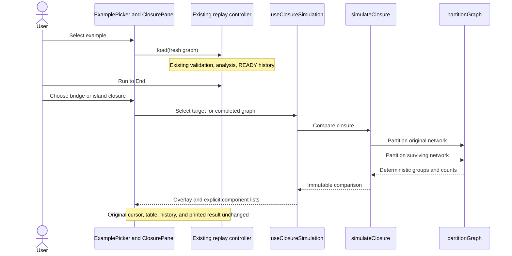

# Graph exploration design

## Responsibilities

| Module | Responsibility |
| --- | --- |
| data/createExampleGraph.ts | Fresh valid festival/cycle/root/disconnected example graphs and catalog labels. |
| domain/models/ClosureSimulation.ts | Typed single closure, component partitions, and immutable comparison result. |
| domain/graph/partitionGraph.ts | Pure flood fill with stable group/ID order, optionally omitting one edge or node and its incident edges. |
| application/simulateClosure.ts | Validate target existence, compare original/surviving partitions, record removed items, and freeze owned results. |
| application/criticalProofSelectors.ts | Select only a classified item's proof from the visible snapshot and replayed prefix. |
| presentation/hooks/useClosureSimulation.ts | Bind a scenario to the completed graph; preserve baseline replay and clear visible exploration on replacement/reset/failure. |
| ExamplePicker / ClosurePanel | Native example and closure controls, component lists, Escape/clear behavior. |
| IslandMap / SafetySummary | Overlay closure/component styling and expose recorded proof selection. |

No existing Tarjan, validation, replay reducer, selector, or useReplayController implementation changed. All original analysis calls still occur through explicit Load. Closure comparison calls flood fill, never the analyzer.

## Example data

| Example | Expected behavior |
| --- | --- |
| Festival archipelago | Original eight islands, nine edges, one component, bridges CD/EG/GH and articulations C/D/E/G. |
| Cycle only | Three islands/three edges, one component, no critical item. |
| Branching root | A has two DFS-tree children; bridges AB/AC, articulation A. |
| Disconnected + isolated | A has two children; D-E is a separate component; F is isolated. Roots A/D/F, discovery clock 0..5. |

The catalog is an action selector labeled Load example graph: selecting an example immediately validates/prepares it and returns the control to its prompt. Reset uses the controller's independently captured original, not the selected example.

## Connectivity comparison

The original graph remains the input to the original replay. The simulation partitions its surviving nodes/edges without mutating that graph or constructing a replacement replay.

Groups and members are sorted by ASCII ID. Each node maps to a zero-based group index for color presentation; visible lists use one-based component numbers. Removed nodes have no group; incident edges are recorded as removed. Results, group arrays, membership records, target, and removed-edge IDs are frozen.

The comparison reports whether component count increases. For an already disconnected network it compares against the original count, not against one. Removing an isolated node can decrease the count; removing the final node yields zero surviving components. The engine validator still requires at least one input node.

Two flood-fill passes take O(V+E) core work, with sorting for stable output. Auxiliary space is O(V+E). There is no extra event history and no change to the existing snapshot complexity.

## Replay and presentation invariants

- Closure selection is enabled only at COMPLETED, preventing early disclosure during a normal replay.
- The selection is bound to the owned current graph object. Each successful load captures a new object, so old scenarios cannot reappear after Reset or replacement.
- Reset/error/replacement closes the native disclosure and clears visible overlay/result state.
- Escape closes the popover while retaining an active overlay. Clear simulation removes the overlay.
- The closure marker and component colors are overlays. Data-state/current/AP markers retain baseline meaning.
- Baseline component count, classifications, node values, history, and printed report remain unchanged.
- Simulation checks connectivity only. It does not recalculate critical items in the surviving network.
- Critical chips select a reached proof without changing focus, cursor, history, or analysis calls. The displayed event number identifies the recorded proof.
- Print media hides exploration along with the other interactive controls.

## Repository checks

.github/workflows/quality.yml runs on push, pull_request, and workflow_dispatch. Its Ubuntu job selects Node 22, installs locked dependencies with npm ci, and runs tests/build/lint as separate steps. It grants contents: read, disables persisted checkout credentials, cancels superseded runs for the same ref, and bounds the job to ten minutes.

Checkout is pinned to a commit; setup-node uses its immutable v7.1.0 release tag. Version references were checked against the official [checkout releases](https://github.com/actions/checkout/releases) and [setup-node releases](https://github.com/actions/setup-node/releases).

The workflow is ready for a GitHub repository. This local checkout has no remote, so no hosted run or badge is claimed. The local test/build/lint steps passed; clean installation and Linux execution will be verified by the first hosted run.

[Editable exploration sequence source](diagrams/sequence-exploration.mmd)
